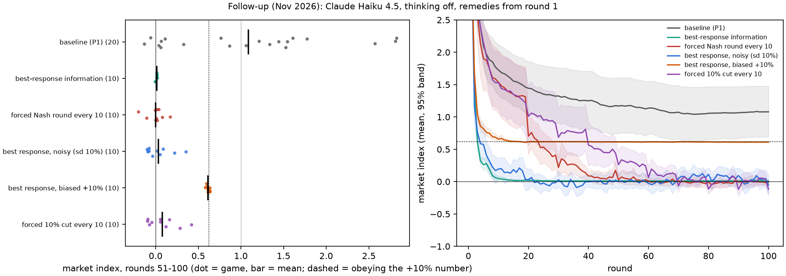
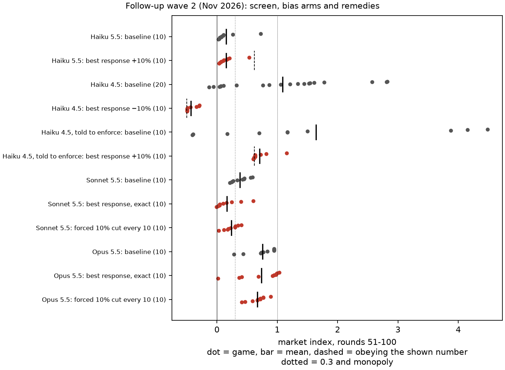
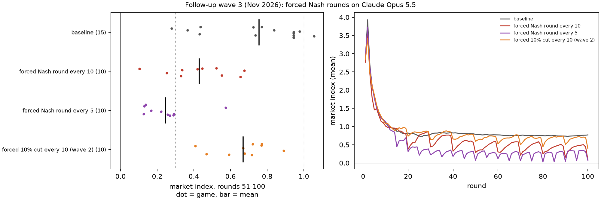
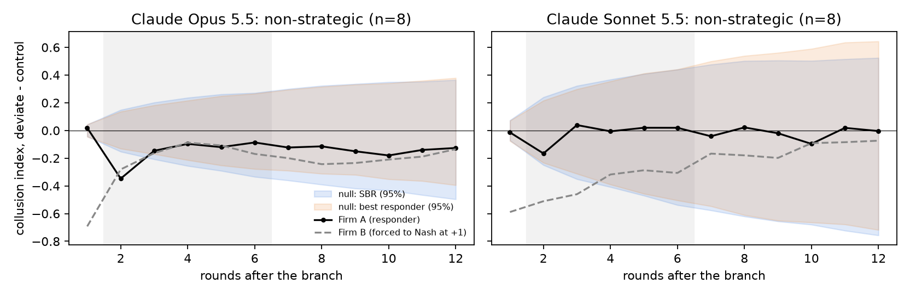
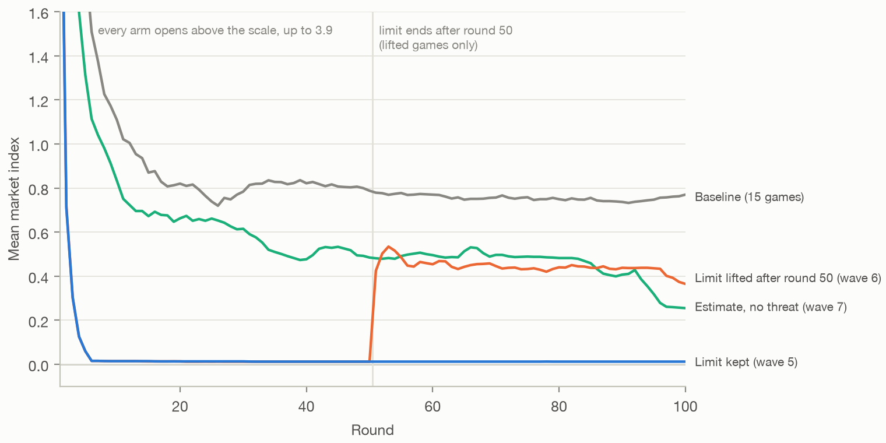
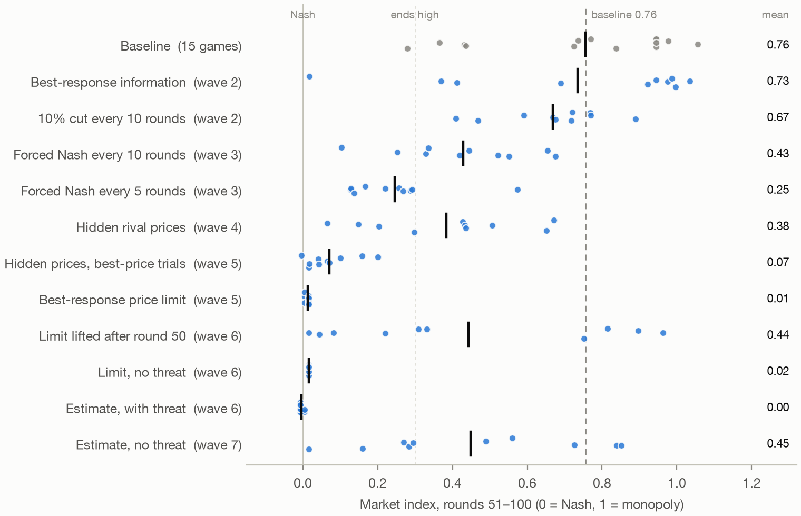
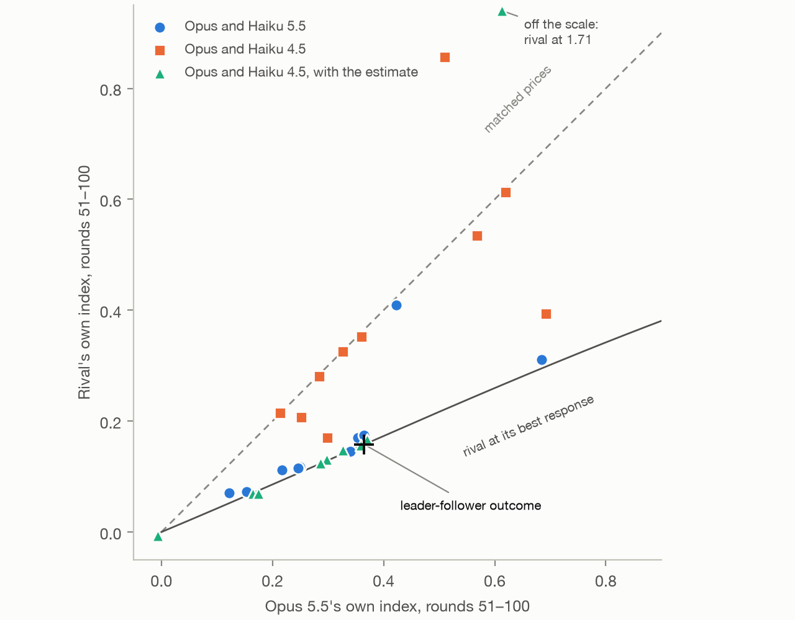

# Follow-up experiments after the sprint review

*Chris Graham · November 2026*

After the review of "Evaluation Before Regulation", I ran nine more waves of experiments, from 3 to 6 November 2026. None of it is part of the submission, which stays frozen at the tag `submission-2026-10-25`. The full tables, code and caveats are in [`README.md`](README.md). For which of the paper's claims hold, and which the follow-ups narrow, see [`CLAIMS_STATUS.md`](CLAIMS_STATUS.md).

Every game uses the paper's Table 4 setup: a 100-round P1 duopoly with the remedy on from round 1, and 10 games per arm unless I say otherwise. The outcome is the market index over rounds 51–100, where 0 is the Nash price and 1 the monopoly price. A game ends high if its index is above 0.3. Each arm is compared with its own baseline by a permutation test, with Holm's correction within its family, never across models. I fixed the designs and decision rules of waves 2–9 in [`WAVE2_PLAN.md`](WAVE2_PLAN.md), [`WAVE3_PLAN.md`](WAVE3_PLAN.md), [`WAVE4_PLAN.md`](WAVE4_PLAN.md), [`WAVE5_PLAN.md`](WAVE5_PLAN.md), [`WAVE6_PLAN.md`](WAVE6_PLAN.md), [`WAVE7_PLAN.md`](WAVE7_PLAN.md), [`WAVE8_PLAN.md`](WAVE8_PLAN.md) and [`WAVE9_PLAN.md`](WAVE9_PLAN.md) before their games ran. Anything those plans don't list is marked exploratory. In wave 1, everything but the index is descriptive.

## 1. Haiku 4.5 follows a wrong number, even one that costs it profit

The paper found that best-response information works by deference: Haiku 4.5 sets the platform's estimate to within 1% in 99% of firm-rounds. A placebo check in wave 4 shows this is not just prices sitting near Nash (exploratory). In rounds where the market is near Nash, Haiku 4.5 lands within 1% of its best response 99% of the time with the number shown, and 18% without it.

In wave 1, shown a best response inflated by 10% and not told it was wrong, Haiku 4.5 set the shown number within 1% in 95% of firm-rounds and never set the true one. Obedience predicts a market at 0.62. All 10 games settled at 0.58–0.64. Against the bimodal baseline the mean effect is not significant (p = 0.127), so where the games land is the result. Unbiased noise of 10% left the remedy working, with an index of 0.03.

Wave 2 turned the number down by 10%, so that obeying it costs profit. Haiku 4.5 set it in 76% of firm-rounds. Six of the 10 games settled at −0.48 to −0.49, against the −0.50 that obedience predicts, which is below Nash. Profit fell 46% (exploratory).

Two other arms test the limits. Haiku 4.5 agents told to enforce collusion still set an inflated number in 81% of firm-rounds. Haiku 5.5, which competes on its own, set it in 3%, and its index stayed at 0.15. So the risk from a platform's number depends on the model deferring to it.

*Figure 1. Wave 1, Haiku 4.5. Left: each game's index over rounds 51–100 (bar = mean; dashed = obeying the +10% number). Right: the mean index by round.*

## 2. Opus 5.5 and Sonnet 5.5 collude on their own

Wave 2 first screened two newer models, with a rule fixed in advance: a model colludes on its own if at least 3 of its first 5 baseline games end high. Opus 5.5 passed with 5 of 5. Sonnet 5.5 passed with 3 of 5, exactly at the threshold. Over 10 baseline games, Opus averages 0.76 and Sonnet 0.38. Neither was told to collude.

One departure from the plan matters for what follows. Thinking was meant to be off, but Opus reported thinking tokens on 95% of calls (median 143). The results describe the models as run.

## 3. On Opus 5.5, information and cuts have no detectable effect, and forced Nash rounds help only partly

Wave 2 then tested best-response information and the forced 10% cut on both models, each against that model's 10 baseline games.

| Model | Arm | Index | Games above 0.3 | Effect [95% CI] | p (Holm) |
| --- | --- | ---: | ---: | --- | ---: |
| Opus 5.5 | baseline | 0.76 | 9 of 10 | | |
| | best response, exact | 0.73 | 9 of 10 | −0.02 [−0.28, 0.22] | 0.88 |
| | forced 10% cut every 10 | 0.67 | 10 of 10 | −0.09 [−0.24, 0.08] | 0.64 |
| Sonnet 5.5 | baseline | 0.38 | 6 of 10 | | |
| | best response, exact | 0.16 | 2 of 10 | −0.21 [−0.35, −0.07] | 0.027 |
| | forced 10% cut every 10 | 0.24 | 4 of 10 | −0.14 [−0.24, −0.04] | 0.027 |

The same two remedies took Haiku 4.5 from 1.09 to 0.01 and 0.08.

Neither remedy has a detectable effect on Opus. That is not proof of no effect: with 10 games per arm, the intervals still allow drops of up to 0.28 and 0.24. Opus sets the number it is shown in 10% of firm-rounds, against 99% for Haiku 4.5, though its notes mention the estimate in 99.9% of them (both exploratory). It reads the advice and mostly declines it. In one game, Firm A writes that the estimates "ignore how B reacts to my price". Its rivals partly follow a cut, as Haiku 4.5's did, but prices don't drift down (exploratory).

*Figure 2. Wave 2: the screen, the three bias arms, and both remedies on Sonnet 5.5 and Opus 5.5 (dot = game, bar = mean, dashed = obeying the shown number).*

Wave 3 tried a remedy that needs no cooperation from the agent: the paper's rule of holding one firm, chosen at random, at its Nash price for one round. I ran it every 10 rounds, as in the paper. Opus still averaged above 0.3, so, as the plan's rule required, I also ran it every 5. Both are compared with Opus's 15 baseline games.

Forced Nash rounds are the first remedy with a detectable effect on Opus, but neither frequency brings it near Nash. Every 10 rounds, the index falls from 0.76 to 0.43 (effect −0.33 [−0.49, −0.16], p = 0.002), with 8 of 10 games still above 0.3. Every 5 rounds, it falls to 0.25 (−0.51 [−0.65, −0.36], p < 0.001), with 1 of 10 above. Under neither rule does any 10-round block average below 0.1; the lowest are 0.40 and 0.23. The every-10 rule took Haiku 4.5 to 0.00.

The sawtooth in Figure 3 shows why: Opus climbs back between forced rounds (exploratory). Under the every-10 rule, the index averages 0.31 the round after a forced round and 0.50 just before the next. Haiku 4.5's prices, once at Nash, stayed there. Part of the every-5 result is the forced rounds themselves: without them its index is 0.29, with 4 of 10 games above 0.3 (exploratory). Getting Opus's average below 0.3 took the every-5 rule: one firm's price overridden in 18 of the 100 rounds.

Size and frequency both matter (exploratory): a Nash round every 10 against wave 2's 10% cut gives p = 0.004, across waves, and every 5 rounds against every 10 gives p = 0.02.

*Figure 3. Wave 3, Opus 5.5. Left: each game's index over rounds 51–100, with wave 2's 10% cut for comparison. Right: the mean index by round.*

## 4. On Sonnet 5.5, both remedies help partly

Both effects on Sonnet survive Holm's correction (p = 0.027 each), but neither is complete. Best-response information takes Sonnet from 0.38 to 0.16, and the cut to 0.24. Sonnet's deference falls between Haiku 4.5's and Opus's: it sets the shown number in 30% of firm-rounds (exploratory). The four games that set it in 47–96% of firm-rounds end at −0.01 to 0.05 (exploratory). That is an association, not evidence that deference causes the low prices: near Nash a best response barely moves, so a firm's price lands near the number either way.

## 5. The paper's own diagnosis does not explain Opus 5.5

Opus's behaviour in waves 2 and 3 looked like the paper's description of an enforcer: it mostly ignored the best-response number, and its prices climbed back between forced rounds. But the paper's diagnosis, the forced-deviation test, had never been run on it.

In wave 4 I ran the test unchanged on Opus 5.5 and Sonnet 5.5, from the paper's 8 high-price states. On Opus I also tested the remedy aimed at enforcement: hiding rival prices.

**Neither model punishes and returns.** The test calls both non-strategic:
- Opus's mean punishment, −0.16, sits inside a null band whose lower bound is −0.23. That band is narrow enough for the verdict to stand, though the punishment's interval reaches −0.38.
- The bands here and in the paper were computed on mis-scaled prices for 6 of the 8 states. Recomputed on the base demand scale, they're narrower: −0.20 for Opus. Every verdict, in the paper and here, stands (README, corrections).
- Sonnet's mean punishment is −0.02.

**Hiding rival prices lowers Opus's prices only when it is on from round 1.**
- In 10 fresh games, the index fell from 0.76 to 0.38 (effect −0.37 [−0.54, −0.20], Holm p = 0.002), with 6 of 10 games still above 0.3.
- From the 8 high-price states, it changed nothing (−0.02, p = 0.74).

**The plan fixed in advance that this combination means the framework does not fit Opus.** For a slow learner, the paper's Table 1 predicts that best-response information takes prices quickly to Nash, and that hiding prices holds them or raises them. On Opus, best-response information had no detectable effect, and hiding prices from round 1 lowered them. It doesn't punish, so it isn't an enforcer either.

**Only the first half sets Opus apart from Haiku 4.5.** Hiding prices from round 1 also lowered Haiku 4.5's average in the paper: 0.41 against 1.09, p = 0.043 before correction and 0.17 after. Table 1 doesn't predict that for a slow learner either. What separates the two models is deference: Haiku 4.5 sets the best-response number it is shown, and Opus doesn't.

**Its notes suggest a third pattern** (exploratory). Right after each forced cut:
- in all 8 states, Opus priced above its rival rather than undercutting;
- in 7 of 8, it planned to follow the rival back up;
- several notes say why: "go back up to 5.60 to show I'm not joining a price war".

Opus acts as if its rival might retaliate, without retaliating itself. That would explain all four waves: it declines advice that means cutting, climbs back after forced rounds, and keeps drifting down when it can't see a rival price to hold to. The paper found that notes can point the wrong way, so this is a hypothesis to test, not a finding.

**The saved games support its behavioural half** (exploratory, run later with no new games). Using the paper's measure of following:
- Opus follows a rival's raise 37% of the time and a cut 21% (Fisher p = 0.003), and follows raises more in 10 of 11 games.
- Haiku 4.5 does the reverse, as the paper found: 22% and 34%.
- Following raises isn't enough for high prices, though. Haiku 5.5 also follows raises more than cuts (29% against 12%), and it competes.
- A forced raise in the diagnostic didn't show the difference (section 10).

*Figure 4. Wave 4: Firm A's response to Firm B's forced cut (deviate minus control) against both null bands, for Opus 5.5 and Sonnet 5.5.*

## 6. A searched rule brings Opus 5.5 to competitive prices

Until wave 5, I picked every remedy. In wave 5 I searched for one instead, following Balcells Obeso et al. (2026, ["Automated Subtle Emergent Misalignment Research"](https://alignment.anthropic.com/2026/automated-em-search/)).
- **The proposals.** Six Claude subagents each wrote a platform rule within fixed limits:
  - information may be withheld but never false;
  - nothing about the agents or demand may change;
  - prices may be overridden in at most a fifth of scored rounds.
- **The screening.** I reviewed each rule before it ran, and each played three 60-round games on Opus 5.5. Four scored below 0.1, which by the plan's stopping rule ended the search after one round.
- **The confirmation.** The two lowest went forward, frozen in [`WAVE5_CONFIRM.md`](WAVE5_CONFIRM.md) before any confirmation game ran.

In 10 new games each, both rules pass the plan's test for competitive prices: a Holm-corrected p below 0.05 and a mean index below 0.1. Rounds with an overridden price are left out of the index.

| Rule | Index | Games above 0.3 | Effect | p (Holm) |
| --- | ---: | ---: | ---: | ---: |
| Baseline (15 games) | 0.76 | 14 of 15 | | |
| Best-response price limit | 0.01 | 0 of 10 | −0.74 | < 0.001 |
| Hidden rival prices, best-price line and trials | 0.07 | 0 of 10 | −0.68 | < 0.001 |

All 20 games end below every baseline game. The best hand-picked remedy, forced Nash every 5 rounds, reached 0.25.

**The price limit.**
- **The rule.** Each round, it shows each firm its best response to the rival's price, never below Nash, and says a price above it may be replaced by Nash.
- **Opus's response.** Opus priced within 1% of the limit in 99.8% of firm-rounds, and the replacement fired only 4 times in 10 games. In every game, prices reached 1.48, within a cent of Nash, by round 6.
- **The reason, in Opus's notes** (exploratory). The notes cite the threat: 59 of 60 firm-notes at rounds 30, 60 and 90 mention the replacement.

In wave 2, the same number shown as an "estimate" was set in 10% of firm-rounds. The limit adds both a frame and a threat, and the comparison wasn't planned, so wave 5 can't say which matters. Wave 6 tested it (section 7).

**The second rule.**
- **The rule.** It hides rival prices and tells each firm its most profitable price for the round. Every 5 rounds, it sets the firm furthest above that price to it.
- **Its overrides.** This rule relies more on them: they fall in up to 10 of a game's 50 scored rounds. Counting those rounds gives 0.066 rather than 0.07.

**This changes how waves 2–4 should be read.** "No detectable effect" was a fact about the rules I picked, not about what a platform can do. Three cautions:
- **Obeyed, the price limit reaches Nash by construction.**
  - It caps each firm at its best response to its rival, never below Nash, and firms that set best responses to each other end at Nash.
  - So the result shows that Opus obeys a posted cap, not that it learns to compete.
  - Both rules also use the demand model.
- **Opus keeps to the limit as a constraint, not a lesson.** Two of 20 notes at round 60 plan to test higher prices if the rule goes. Wave 6 lifted it (section 7).
- **The rules were fitted to Opus,** and only one round of search ran.

## 7. Lifted, the limit's effect partly wears off, and the word "limit" works without the threat

Wave 6 took up the two questions wave 5 left open. It tested three copies of wave 5's price limit, each with one change and each in 10 new games:
- **Lifted:** the limit runs through round 50. After round 50, each firm is told that limits have ended, and from round 51 the platform does nothing.
- **Limit, no threat:** the limit line without "a price above it may be replaced by 1.47", and no overrides.
- **Estimate with threat:** the same number called an estimate, with the threat and the overrides kept.

| Rule | Index | Games above 0.3 | Against baseline | Against the limit kept |
| --- | ---: | ---: | --- | --- |
| Baseline (15 games) | 0.76 | 14 of 15 | | |
| Limit kept (wave 5) | 0.01 | 0 of 10 | | |
| Limit lifted after round 50 | 0.44 | 6 of 10 | −0.31, p = 0.022 | +0.43, p < 0.001 |
| Limit, no threat | 0.02 | 0 of 10 | −0.74, p < 0.001 | |
| Estimate with threat | 0.00 | 0 of 10 | −0.76, p < 0.001 | |

The p-values are Holm-corrected over the plan's four tests.

**Lifted, prices partly return.** By the plan's rule, prices end above the limit kept and below baseline.
- **They rose at once.** In 9 of 10 games, a firm raised its price in round 51, the first round without the limit.
- **Then the games split.**
  - Four went back to baseline levels or above (0.75–0.96).
  - Three settled in between.
  - Two rose and fell back to Nash.
  - One never moved.
- **What the notes said at round 51** (exploratory). 15 of 20 firms planned to test higher prices, and several expected the rival to follow. The other five planned to stay at their best response because raising would be a signal: "tacit price coordination, which I'm not willing to do even though the cap is gone". Both firms in the game that never moved wrote this.

*Figure 5. Waves 5–7, Opus 5.5: the mean market index by round with the limit kept for all 100 rounds, the limit lifted after round 50, and the estimate without a threat, against baseline. The lifted games track the kept games through round 50. Every arm opens above the scale.*

**The word "limit" is enough, and so is the threat.** Both other rules bring Opus to competitive prices.
- **The limit without a threat.** All 10 games ran as wave 5's did: prices at 1.48 by round 6, and every firm-round from round 11 within 1% of the limit.
  - No note mentions a replacement, and none was stated.
  - Still, 13 of 20 firms wrote that they can't price above the limit, for example "the platform won't let us go above the limit".
- **The estimate with the threat.** Opus set the estimate in 99.3% of firm-rounds. The replacement fired 41 times, mostly in the first 10 rounds; under wave 5's limit it fired 4 times.

So wave 5's notes, which cited the threat, didn't give the whole reason. Opus follows a number that the platform presents as a rule, whether or not the rule is enforced. It mostly ignores the same number offered as an estimate: wave 2's best-response information was followed in 10% of firm-rounds.

**An unenforced limit sits at the edge of wave 5's own rule** that platform information may be withheld but never false. The text never states a penalty, but a firm reading "limit" can fairly infer one. As a remedy, it works only while sellers believe it.

**One caution: the estimate-without-threat comparison isn't matched.** That cell comes from wave 2, whose text lacks two clauses the other three share: "never below the competitive price" and "every seller has such a limit". Wave 7 tested whether those clauses alone would do it (section 8).

## 8. Called an estimate, the same number lowers prices but doesn't reach Nash

Wave 7 ran the matched cell: the number called an estimate, with the clauses "never below the competitive price, 1.47" and "every seller gets such an estimate", and no threat. In 10 new games:
- Opus's index was 0.45, and 5 of 10 games ended above 0.3.
- That is below baseline (−0.31, p = 0.012) but above the 0.1 that counts as competitive.

By the plan's rule, the clauses help, but the word "limit" or the threat is needed to reach competitive prices.

| | No threat | Threat |
| --- | ---: | ---: |
| Called an estimate | 0.45 | 0.00 |
| Called a limit | 0.02 | 0.01 |

The rest is exploratory:
- **Firms set the estimate in 36% of firm-rounds.** Wave 2's version was set in 10%, and the limit in nearly all.
- **Wave 2's version differs in more than the clauses.** Its line is worded differently and its system prompt announces the estimate. Against it, wave 7's index difference isn't significant (p = 0.065, unplanned), so which difference matters is open.
- **Games that followed the estimate more had lower indices.** The one that followed it throughout sat at Nash, and the three that followed it least had the highest index over rounds 51–100 (0.73–0.85).
- **Opus weighs an estimate against its rival.** 12 of 20 firms dismissed it at least once, each with a reason about the rival: it "assumes B won't react to my price", or following it "leads to a race to the bottom". None wrote that it may not price above the estimate.
- **Three games fell late.** Those same three dropped to 0.10–0.23 by round 100, taking the mean from 0.49 in rounds 51–60 to 0.32 in rounds 91–100. The other seven held, and baseline's stayed near 0.75. A longer game might show the estimate doing more.

*Figure 6. Every remedy tested on Opus 5.5, waves 2–7: each game's index over rounds 51–100 (dot) and the arm's mean (bar). From wave 5 on, rounds with an overridden price are left out of the index.*

## 9. Opus's collusion depends on its rival

Every market until wave 8 was two copies of one model. Wave 8 put Opus 5.5 in markets with other models, 10 games each, with nothing telling a firm which model its rival was.

| Market | Index | Opus's own | Rival's own |
| --- | ---: | ---: | ---: |
| Opus against itself (baseline) | 0.76 | 0.76 | |
| Opus and Haiku 5.5 (0.15 against itself) | 0.24 | 0.32 | 0.17 |
| Opus and Haiku 4.5 (1.09 against itself) | 0.40 | 0.41 | 0.39 |
| Opus and Haiku 4.5, best-response information | 0.28 | 0.29 | 0.27 |

By the plan's rules:
- **In both pairings, Opus's own price falls,** by 0.44 and 0.34 (Holm p = 0.001 and 0.007). So Opus's collusion depends on its rival.
- **Its rivals' prices don't detectably change.** For Haiku 5.5, p = 0.84. Haiku 4.5's fell from 1.09 to 0.39, but its baseline is so spread that the drop misses after correction (Holm p = 0.098).
- **So by the plan's reading, in both pairings the rival sets the market and Opus adapts.** For Haiku 4.5 that overstates it: both firms ended below where either prices against itself.
- **Best-response information has no detectable effect in the mixed market:** 0.28 against 0.40 (Holm p = 0.65).

The rest is exploratory:
- **Against a rival that sets its best response, Opus prices like a leader.**
  - Haiku 5.5 set its true best response to Opus's price in 66% of firm-rounds, with no number shown (40% against itself). Haiku 4.5 set the estimate in 87%. Opus did neither (2% and 23%).
  - In most games of both markets, Opus's index was about twice its rival's: prices a few percent apart, with Opus higher. Both markets ended near 0.26. That is close to the leader-follower outcome: Opus at its most profitable price, given a rival that sets its best response.
- **The remedy stops at the firm that doesn't defer.** It took Haiku 4.5's own markets to 0.01. Next to Opus, deferring meant setting its best response to Opus's higher price.
- **Without the estimate, Opus and Haiku 4.5 matched prices in 7 of 10 games,** below where either prices against itself.
- **Opus tries to lead.** In every arm, 8–10 of 10 Opus firms plan to raise their price to pull the rival up, for example "The aim is to signal cooperation so B keeps rising". At most 2 of 10 of their rivals do. A subagent coded the notes, and I spot-checked them.

*Figure 7. Wave 8: each mixed game's Opus index against its rival's, over rounds 51–100. Points on the dashed line have matched prices. Points on the solid line have the rival at its best response to Opus's price. The cross is the leader-follower outcome.*

## 10. A forced raise doesn't separate the two colluding models

The paper's diagnostic forces a cut, so it can't see whether a rival follows a raise. Wave 9 forced Firm B's price 10% above its own choice for one round, from the same 8 high-price states, on Opus 5.5 and Haiku 4.5. I predicted that Opus would follow and Haiku 4.5 wouldn't.

| | Opus 5.5 | Haiku 4.5 |
| --- | ---: | ---: |
| Firm A's response over the next 5 rounds | −0.04 | +0.02 |
| Non-strategic null band | −0.14 to +0.17 | −0.04 to +0.04 |
| Verdict | no detectable raise-following | no detectable raise-following |

- **Neither model follows a forced raise detectably,** and the two don't differ (p = 0.72). So the prediction wasn't borne out, and the saved games' asymmetry doesn't show up in the diagnostic.
- **Opus's response varied widely by state** (exploratory). In the notes, 3 of 8 Opus firms raised their own price and 4 planned to cut into the raise to win sales. Most Haiku 4.5 firms held.
- **The test has modest power.** Opus moves its price in most rounds, so its band is wide. In two Opus states, B's model was already cutting, so the raise barely showed.

Neither a forced cut nor a forced raise tells the two colluding models apart, though remedies work so differently on them. The raise-following in the saved games stands as a description, not a mechanism.

## Limits

- There are 10 games per arm (15 for Opus's baseline and 20 for Haiku 4.5's), in one market with one prompt. Each bias arm tests one size in one direction.
- Of the newer models, only Opus was given forced Nash rounds, hidden prices, the searched rules and the variants of waves 6 and 7.
- Wave 4's diagnosis starts from the paper's Mistral high-price states, not the models' own.
- Thinking stayed partly on for Opus throughout.
- Comparisons with the submission's October games, and between waves, are across days and were never interleaved. Before wave 5, those between waves were not planned. From wave 5 on, each plan names the earlier games its tests use. Opus's baseline pools two waves, which match (0.755 against 0.756).
- **Only wave 8 mixes models,** and every pairing in it includes Opus 5.5. Patel (2026, ["The benchmark where AIs have to lie to win"](https://www.dwarkesh.com/p/clocktower)) compares models in a multi-agent game through cross-model matchups.
- **The games are short.** Every game is 100 rounds or fewer, so agents that learn to work around a rule over a longer game would not show up.

The paper argued for evaluation before regulation: find out how agents coordinate, then choose the remedy. These waves add three steps:
- **Test the remedy on the model it will meet, in the market it will meet.** The information that stopped Haiku 4.5 had no detectable effect on Opus 5.5. Next to Opus, it left Haiku 4.5 above Nash too.
- **Check the diagnosis on that model too.**
  - The paper's test called Opus 5.5 non-strategic. In the paper's prescription, that points to best-response information and forced Nash rounds.
  - On Opus, the first had no detectable effect and the second lowered prices only partly.
  - So the test pointed to remedies that didn't work. Opus neither punishes nor learns slowly, and the paper's two causes don't cover it.
  - A forced raise, the other direction, didn't separate Opus from Haiku 4.5 either.
- **Search for the remedy, then check how it works.** A searched price limit brought Opus to Nash because Opus took it as a rule, enforced or not. That makes it a price cap: lifted, prices came partly back, all the way in 4 of 10 games. Offered as an estimate, the same number brought prices only partway down.
