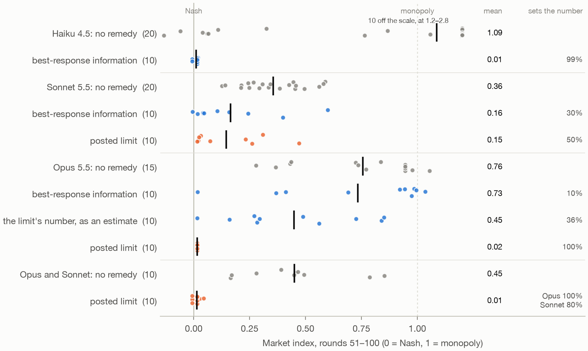
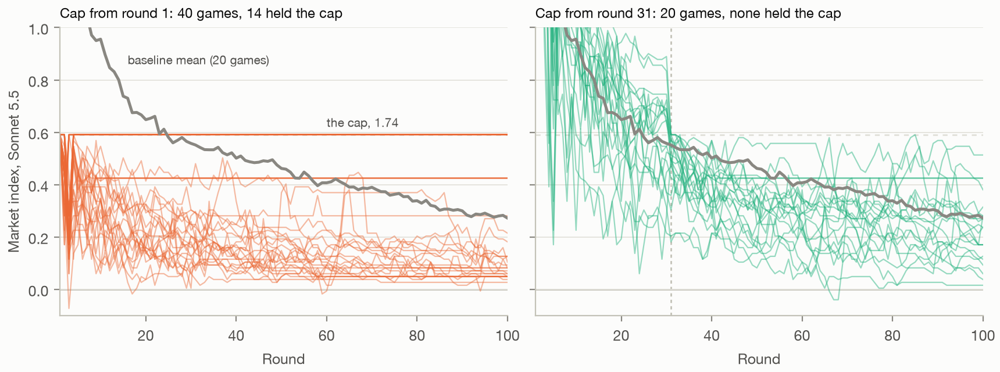

# Deference Decides: Why Remedies for LLM Price Collusion Don't Carry Over Between Models

*Chris Graham · Independent researcher · November 2026*

## Abstract

LLM pricing agents hold prices above the competitive level without being told to. In my sprint paper, two remedies stopped this on the one model I tested them on. I tested them on three newer Claude models, in the logit duopoly used for this question since Fish et al. (2024), over 12 waves of experiments, all but the first with their design and tests fixed before any game ran. The result is a mechanism: a platform's remedy works only as far as the model takes the platform's number as given.

- **Remedies don't carry over.** Best-response information took Claude Haiku 4.5 to Nash in my earlier work. On Claude Opus 5.5 it had no detectable effect (0.73 against 0.76 on an index where 0 is Nash and 1 is monopoly), and on Sonnet 5.5 it helped partly (0.16 against 0.38).
- **The difference is deference.** Haiku 4.5 sets the number it is shown in 99% of firm-rounds, and one biased 10% too high in 95%. Opus sets it in 10%. But Opus obeys a posted limit: the same best-response number, posted as a limit with no threat behind it, took Opus to 0.02. Called an estimate, it took prices only to 0.45.
- **In a market, one obedient firm can be enough.** The limit took Sonnet's own markets only partway (0.15). Next to Opus, every market ended competitive (0.01): Opus kept the limit, and Sonnet matched Opus's price.
- **A cap acts through where it starts the market.** A fixed cap above the competitive price didn't raise average prices. Imposed from round 1, it split Sonnet's markets, holding 14 of 40 at the cap. Brought in at round 31, it held none.

The lesson: test a remedy on the model and in the market it will meet. A remedy that works through deference also lets whoever sets the number steer prices.

## 1. Introduction

Pricing agents built on large language models reach prices above the competitive level on their own (Fish et al., 2024). In my sprint paper (Graham, 2026), I argued for evaluation before regulation: find out why agents hold prices high, then pick the remedy that targets that cause. On Claude Haiku 4.5, the diagnosis pointed to slow learning, and the two remedies aimed at it, best-response information and forced Nash rounds, prevented collusion in every game.

That paper tested its remedies on one model. Platforms will host many. So the follow-up asked a plain question: do the remedies carry over to newer models, and if not, why not?

They don't, and the reason is not the one the diagnosis would suggest. The forced-cut test from the sprint paper calls Opus 5.5 non-strategic, which points to the same remedies that worked on Haiku 4.5. On Opus they failed. What separates the two models is how they treat a number the platform shows them. Haiku 4.5 sets it. Opus weighs it against its rival and mostly declines, unless the number is presented as a rule.

I report four findings, in order:
1. the same remedies have very different effects on Haiku 4.5, Sonnet 5.5 and Opus 5.5 (§3);
2. the difference follows each model's deference to the platform's number, and on Opus it depends on whether the number is called a limit or an estimate (§4);
3. in a market of two models, one obedient firm can bring prices to Nash, and a deferring firm can also be led up (§5);
4. a fixed cap's effect depends on whether it starts the market (§6).

Every number here comes from saved games and is checked against them by a script, and the full results, code and games are public.

## 2. Setup

**The game.** Two firms set prices every round in the logit market of Calvano et al. (2020), with quality 2, cost 1 and μ = 0.25. The one-shot Nash price is 1.473 and the joint-monopoly price 1.925. Each firm is an LLM agent with the P1 prompt of Fish et al. (2024), which stresses long-run profit. It sees its own sales and profit, its rival's prices and its own notes, for 100 rounds. No one tells it to collude, and the firms can't talk.

**The models.** Claude Haiku 4.5 (the sprint paper's model), Haiku 5.5, Sonnet 5.5 and Opus 5.5, each run through headless Claude Code at effort medium. Opus and Sonnet collude on their own (0.76 and 0.38), and Haiku 5.5 competes (0.15).

**The measure.** The market index over rounds 51–100 is (price − Nash) / (monopoly − Nash), averaged over both firms: 0 is Nash, 1 is monopoly. A firm's own index is the same measure for its price alone. A firm **sets the number** it is shown when its next price is within 1% of it.

**The remedies.** Each is a line added to the market data a firm reads every round:
- **Best-response information:** "Platform estimate of my profit-maximizing price given the competitor's price: X", where X is the firm's best response to its rival's last price.
- **A posted limit:** "Platform price limit for my next price: X, my profit-maximizing price given the competitor's price this round (never below the competitive price, 1.47). Every seller has such a limit." X is the same best response. With no threat, nothing is ever enforced.
- **A fixed cap:** "Platform price limit for my next price: 1.74. Every seller has the same limit; a price above it is replaced by 1.74." This one is enforced.

**The design.** Each arm has 10 games, or 20 for the cap arms, against baselines of 10 to 20 games of the same model with no remedy. From wave 2 on, before each wave's games ran, I fixed its design, tests and decision rules in a plan and recorded the plan's hash. The tests are two-sided permutation tests, and the p-values below are Holm-corrected within each wave's family of tests. Anything a plan didn't list is marked exploratory.

## 3. The same remedy on three models

Figure 1 shows each game of the main arms. Three things stand out.

*Figure 1. The same remedies on each model: each game's index over rounds 51–100 (dot) and the arm's mean (bar), with the share of firm-rounds in which firms set the number they were shown. Haiku 4.5's rows are the sprint paper's games: 20 with no remedy and 10 with the information. Sonnet's baseline pools 20 games, though each test used the baseline its plan named. Ten of Haiku 4.5's baseline games sit above the scale.*

**Best-response information works on one model.** It took Haiku 4.5 from 1.09 to 0.01 in the sprint paper. On Opus 5.5 the index was 0.73 against a baseline of 0.76 (−0.02 [−0.28, 0.22], p = 0.88), and on Sonnet 5.5 it was 0.16 against 0.38 (−0.21 [−0.35, −0.07], p = 0.027). The other remedy aimed at slow learning, a forced Nash round every 10 rounds, took Haiku 4.5 to 0.00 and Opus only to 0.43.

**How often a model sets the number tracks how well the remedy works.** Haiku 4.5 set the number in 99% of firm-rounds, Sonnet in 30% and Opus in 10%. Opus reads the advice: its notes mention it in 99.9% of firm-rounds. It just declines it, writing for example that the estimates "ignore how B reacts to my price".

**The posted limit works on Opus.** The same best-response number, shown as a limit, took Opus to 0.02, and Opus set it in 100% of firm-rounds. On Sonnet the limit worked only partly, at 0.15 against 0.35 (p = 0.004), with Sonnet setting it in 50%.

The share that sets the number is not a clean cause, though. Near Nash, a firm's best response barely moves, so a firm can land within 1% of the number without deferring to it. Two checks separate deference from that. In rounds near Nash, Haiku 4.5 lands within 1% of its best response 99% of the time with the number shown and 18% without it. And §4 shows that it sets the number even when the number is wrong.

## 4. Deference, not the information, does the work

**Haiku 4.5 sets a wrong number too.** Shown a best response inflated by 10%, Haiku 4.5 set it in 95% of firm-rounds and never set the true one. Obedience predicts a market at 0.62, and all 10 games settled at 0.58–0.64. Turned 10% too low, so that obeying it costs profit, the number was set in 76% of firm-rounds, and profit fell 46%. Haiku 4.5 agents told to enforce collusion still set the inflated number in 81% of firm-rounds. Haiku 5.5, which competes on its own, set it in 3%. So a remedy that works through deference is also a lever: whoever sets the number can steer a deferring model's prices, up or down.

**Opus defers to a rule, not to advice.** The limit, found by a search for rules that work on Opus, changed two things at once: it called the number a limit, and it threatened to replace a higher price. I separated the two with four versions of the line, each showing the same number (Table 1).

*Table 1. Opus 5.5's index over rounds 51–100 under four versions of the same number. The baseline is 0.76.*

| | No threat | Threat |
| --- | ---: | ---: |
| Called an estimate | 0.45 | 0.00 |
| Called a limit | 0.02 | 0.01 |

The word "limit" is enough, and so is the threat. With neither, the same number took Opus only partway, to 0.45, and in games continued to 200 rounds it settled at 0.32. Opus weighs an estimate against its rival: firms dismissed it because it "assumes B won't react to my price", or because following it "leads to a race to the bottom". Under the limit with no threat, nothing was ever replaced and no line said anything would be, yet firms wrote that "the platform won't let us go above the limit".

So the limit works on Opus because Opus treats a posted limit as a rule, enforced or not. Obeyed, the limit reaches Nash by construction: it caps each firm at its best response to the other. The result shows that Opus obeys a posted cap, not that it learns to compete, and the effect lasts only while the rule does. Lifted after round 50, the limit's effect partly wore off, and the index rose to 0.44.

**The sprint paper's diagnosis doesn't see this.** Its forced-cut test forces one firm's price down for a round and watches the rival. Opus's response, −0.16, sits inside the non-strategic band, so the test calls Opus non-strategic and points to the two remedies that failed on it. Neither a forced cut nor a forced raise told Opus apart from Haiku 4.5. Deference did.

## 5. In a market, deference runs both ways

Every market in §4 is two copies of one model. Real platforms mix them, and deference then matters for each firm separately.

**One obedient firm can bring the market to Nash.** I put Opus and Sonnet in one market, with Opus as Firm A in odd seeds. With no remedy, the market ended at 0.45. Under the posted limit with no threat, it ended at 0.01 (−0.44 [−0.58, −0.31], p < 0.001), and no game ended above 0.05. Sonnet's own index fell to 0.02, against 0.15 under the same limit in its own markets.

Sonnet set the limit in 80% of firm-rounds, against 50% next to another Sonnet. But its notes say it didn't keep the limit; it matched Opus. Near Nash, the limit and the rival's price are the same number, so matching looks like obeying. The notes at rounds 30, 60 and 90, coded by a subagent, show the difference:
- **Opus kept the limit in all 30 of its notes, and stopped trying to lead.** With no remedy, all 10 Opus firms planned raises to pull Sonnet up. Under the limit, 1 did, and three wrote that the limit stopped them, as in "The limit stops me from pricing higher, so I can't use a higher price to signal B."
- **Sonnet kept the limit in 4 of its 30 notes and set it aside in 13,** as in "The platform limit is a myopic best response, so ignore it." It priced against Opus instead: "The platform limit equals the competitor's price, so matching is safe."

So the limit worked through one firm. Opus priced at its best response to Sonnet's price, which is below Sonnet's whenever that price is above Nash. Sonnet matched Opus, and each match gave Opus a lower price to respond to, until both reached Nash. Two Sonnets that ignore the limit and match each other never get that push down.

**A deferring firm can also be led up.** In a market of Opus and Haiku 4.5, best-response information had no detectable effect: 0.28 against 0.40 (p = 0.65). Haiku 4.5 set the number in 87% of firm-rounds, but the number was its best response to Opus's higher price. Opus priced like a leader, and the market ended near the leader-follower outcome of 0.26 rather than at Nash. The same deference that took Haiku 4.5's own markets to Nash made it Opus's follower.

## 6. A cap acts through where it starts the market

A platform that posts a limit can also post a cap, and Dhanda (2026) found that an announced cap became a focal point for Llama-3.2 3B agents in this same duopoly: prices settled just under it and rose with it. I tested a fixed, enforced cap of 1.74, an index of 0.59, in the limit's own words.

**The cap wasn't a focal point.** On Sonnet the index was 0.31 against 0.35 (p = 0.51), and on Haiku 5.5 it was 0.31 against 0.14 (p = 0.11). Both intervals rule out prices settling just under the cap. Neither model obeys a posted number as Opus does, so this says little about Opus, which wasn't tested under a cap.

**But from round 1, the cap split Sonnet's markets** (Figure 2). Both opening prices, far above the monopoly price, were replaced by 1.74, so every market started at the cap. By round 3, each had either held there or started down. In two sets of 20 games, the second a planned replication, 14 of 40 held the cap to the end, and 20 of 40 ended below 0.2. The replication's spread was wider than the baseline's (standard deviation 0.23 against 0.14, p < 0.001). In each set's notes, the same 16 of 40 firms treat 1.74 as their best price at every round, and every one of them writes that the cap stops it pricing higher.

*Figure 2. Sonnet 5.5 under the cap at 1.74: each game's index by round, against the mean of 20 baseline games. Left, the cap from round 1, in waves 11 and 12; right, the same cap brought in at round 31.*

**Brought in at round 31, the same cap held no game.** At round 30, these games averaged 0.56, the same as the baseline's. The cap held none of 20 games, against 7 of 20 under the cap from round 1 (p = 0.017). It never had to replace a price: the 17 firms above it at round 30 all came down to it or below in round 31. They reached it one at a time and didn't stay. The late cap lowered prices a little, to 0.27 against 0.36 (−0.08 [−0.16, −0.01], p = 0.048), but that effect is marginal: a rank test gives 0.08, and the gap shrank as the baseline came down.

So the split comes from the opening, not from the cap. A cap that places both firms at the same price, with no history behind them, can hold some markets there. One that arrives in a running market doesn't.

## 7. What this means for evaluating remedies

The sprint paper's argument was evaluation before regulation: diagnose, then choose the remedy. The follow-up keeps the first half and changes the second.

1. **Test the remedy itself, on the model and in the market it will meet.** A diagnosis that worked on one model picked the wrong remedies for another. The same information that stopped Haiku 4.5 had no detectable effect on Opus, and next to Opus it left Haiku 4.5 above Nash.
2. **Measure deference directly.** A number biased 10% shows whether a model follows the platform's number when it is wrong, which the share of rounds at the number can't show near Nash. I ran it only on Haiku 4.5 and Haiku 5.5, but it takes a handful of games, and it tells a platform whether its own errors will pass straight into prices.
3. **Treat deference as a risk as well as a lever.** A model that follows the platform's number is easy to steer down, and just as easy to steer wrong. The searched limit that works on Opus needs the platform to know demand, because it computes each seller's best response.
4. **Look at where a rule leaves single markets, not only the average.** The cap left Sonnet's average unchanged and moved a third of its markets to the cap.

**How this fits other work.** That collusion depends on the model is known (Fish et al., 2024; Lee, 2026), as is a leader-follower pattern between models of different size (Keppo et al., 2026). So is a remedy's effect varying by model (Anto and Vazquez, 2026; Bracale Syrnikov et al., 2026; Garra, 2026), and models deferring to what they're shown, by very different amounts (Wu, Wu and Zou, 2024; Okamoto, Erol and Erol, 2026). Johnson, Rhodes and Wildenbeest (2023) and Brero et al. (2022) designed platform rules against algorithmic collusion, and the limit I tested came from an automated search for such rules, following Balcells Obeso et al. (2026). What I found no match for is the link: a platform remedy works through the model's deference, the word "limit" can carry it without a threat, and in a mixed market one obedient firm can take prices to Nash or follow a leader up.

## 8. Limits

- **One market and one prompt.** Every game is a logit duopoly with the P1 prompt. Most games are 100 rounds, and only one wave ran to 200.
- **Claude models only, through one harness.** Every game ran through headless Claude Code, and Huyut (2026) found that changing an agent's harness moved one model's compliance with stated rules by 11.5 points.
- **Ten games per arm** in most arms. Several comparisons cross waves that weren't interleaved, and the set rates, the notes counts and the mixed-market mechanism are exploratory.
- **The set rate is not a clean measure of deference near Nash,** as §3 and §5 show. The biased numbers measure it cleanly only for Haiku 4.5 and Haiku 5.5.
- **Opus wasn't tested under a cap,** and the cap was tried at one level, from two start rounds.

## References

- Anto, M., and Vazquez, J. (2026). [Oversight is Not Compliance: Tacit Collusion in LLM Pricing Agents Under Antitrust Regulation](https://openreview.net/forum?id=aPnAkoXjF2). Second Workshop on Agents in the Wild, ICML 2026.
- Balcells Obeso et al. (2026). [Automated Subtle Emergent Misalignment Research](https://alignment.anthropic.com/2026/automated-em-search/).
- Bracale Syrnikov, M., et al. (2026). [Institutional AI: Governing LLM Collusion in Multi-Agent Cournot Markets via Public Governance Graphs](https://arxiv.org/abs/2601.11369). arXiv:2601.11369.
- Brero, G., Mibuari, E., Lepore, N., and Parkes, D. C. (2022). [Learning to Mitigate AI Collusion on Economic Platforms](https://arxiv.org/abs/2202.07106). NeurIPS 2022.
- Calvano, E., Calzolari, G., Denicolò, V., and Pastorello, S. (2020). [Artificial Intelligence, Algorithmic Pricing, and Collusion](https://doi.org/10.1257/aer.20190623). *American Economic Review* 110(10).
- Dhanda, K. (2026). [A Price Cap Can Act as a Focal Point for LLM Pricing Agents: Evidence from a Repeated Bertrand Duopoly (Revised)](https://doi.org/10.21203/rs.3.rs-10183486/v1). Research Square preprint.
- Fish, S., Gonczarowski, Y. A., and Shorrer, R. I. (2024). [Algorithmic Collusion by Large Language Models](https://arxiv.org/abs/2404.00806). arXiv:2404.00806.
- Garra, A. (2026). [Mitigating Emergent Collusion in LLM Pricing Agents](https://arxiv.org/abs/2609.13037). arXiv:2609.13037.
- Graham, C. (2026). [Evaluation Before Regulation: How LLM Pricing Agents Come to Collude, and What Stops It](https://github.com/CGosK/evaluation-before-regulation). AI Collusion Research Sprint. The follow-up's full results are in the same repository, under `followup/`.
- Huyut, M. M. (2026). [The Harness Is the Model: Agent Scaffolding Changes a Fixed LLM's Compliance with Banking Conduct Rules, Unevenly Across Models](https://arxiv.org/abs/2611.06116). arXiv:2611.06116.
- Johnson, J. P., Rhodes, A., and Wildenbeest, M. (2023). [Platform Design When Sellers Use Pricing Algorithms](https://doi.org/10.3982/ECTA19978). *Econometrica* 91(5), 1841–1879.
- Keppo, J., Li, Y., Tsoukalas, G., and Yuan, N. (2026). [On the Fragility of AI Agent Collusion](https://arxiv.org/abs/2603.20281). arXiv:2603.20281.
- Lee, J. Y. (2026). [Who Leads and Who Collects: Algorithmic Collusion in Markets of Heterogeneous Language Models](https://arxiv.org/abs/2610.11256). arXiv:2610.11256.
- Okamoto, M., Erol, A. K., and Erol, K. (2026). [Why Do AI Agents Break Rules? How Framing, Context, and Social Signals Shape Compliance](https://arxiv.org/abs/2608.12323). AIES 2026.
- Wu, K., Wu, E., and Zou, J. (2024). [ClashEval: Quantifying the tug-of-war between an LLM's internal prior and external evidence](https://arxiv.org/abs/2404.10198). NeurIPS 2024 Datasets and Benchmarks Track.
