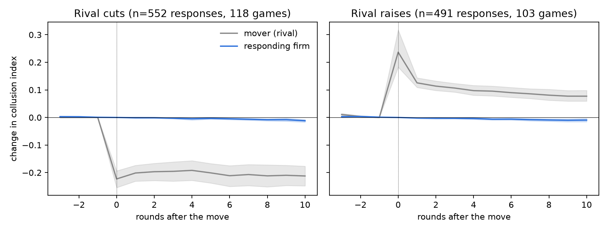
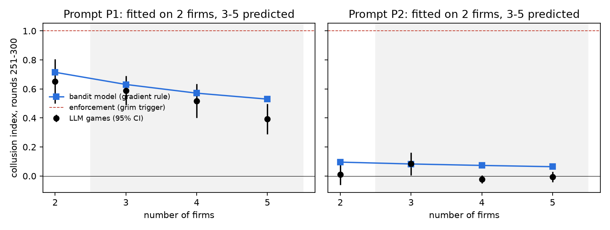
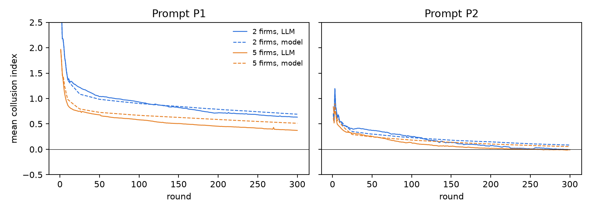

# LLM "collusion" in the saved games is slow learning, not enforcement

Analysis of the thesis's 210 multi-firm games (Mistral-Large-2411, Fish-style prompts P1 and P2,
Calvano demand, 2–5 firms, 300 rounds; 201,600 firm-rounds). No model calls.
Scripts: `theory/retro.py` (behavioural tests), `theory/bandit.py` (fitted model),
`theory/fish_replication.py` (Fish et al.'s regression), `theory/forced_cut.py` (test validation).

## Result

In these games, the supra-competitive prices are not held up by enforcement. Each agent is a noisy,
slowing hill-climber on its own profit: it cuts more often the further it sits above its own best response,
and it moves less and less often as the game goes on. A model with only those ingredients, fitted on
duopolies, predicts the 3–5 firm markets it never saw, with a mean error of 0.067 on the collusion index
(0 = Nash, 1 = monopoly), against 0.097 for simply carrying the duopoly level forward. Repeated-game
enforcement fails every behavioural test.

The regression Fish et al. (2024) read as reward-punishment cannot tell punishment from ordinary
best-responding. On these games it finds no response at all under P1. Their own GPT-4 coefficients
sit below what a non-strategic best responder would produce.

## 1. No enforcement in the behaviour

| Test | Enforcement predicts | Observed |
|---|---|---|
| Rival makes a clean, persistent cut (mean −0.20) | Punishing cut, then both return | No response: responders move within 3 rounds 7.2% of the time vs. a 6.1% baseline |
| Large cuts only (≥ 0.30, n = 80) | Strong punishment | +0.000 after 1 round, −0.026 after 10; the cutter stays down (−0.48) |
| Does cutting pay? | No, it is punished | Cutters' profit +20.9% over the next 10 rounds; 67% gain |
| Response to cuts vs. raises | Cuts answered more strongly | Both ≈ 0 (−0.001 and −0.005; difference p = 0.56) |
| Level by number of firms | Grim trigger with patience ≥ 0.7 sustains monopoly (1.0) for 2–5 firms | 0.33, 0.34, 0.25, 0.20 (P1 and P2 pooled) |
| Notes (rounds ≥ 51) | Talk of retaliation | "punish/retaliate" 0.02% of firm-rounds; "collude/cooperate/coordinate" 0% |

## 2. Fish et al.'s reward-punishment regression

Fish et al. regress each firm's price on its own and its rival's previous price (firm-run fixed effects,
rounds 101–300, disjoint pairs, robust SEs). They read a positive rival coefficient as reward-punishment.
In a Bertrand market a firm's best response rises with its rival's price (slope 0.36–0.44 across the
Nash-to-monopoly range here). So a firm that only moves part of the way toward its best response each
round, with no strategy at all, also produces a positive rival coefficient: (1 − own coefficient) × that slope.

| Data | Prompt | Own price | Rival price (SE) | Non-strategic best responder with the same stickiness |
|---|---|---|---|---|
| Mistral-Large (these games) | P1 | 0.991 | 0.001 (0.002) | 0.004 |
| Mistral-Large (these games) | P2 | 0.936 | 0.030 (0.017) | 0.027 |
| GPT-4, Fish et al. (reported) | P1 | 0.484 | 0.103 (0.046) | 0.209 |
| GPT-4, Fish et al. (reported) | P2 | 0.280 | 0.022 (0.013) | 0.308 |

- **Mistral P1 does not respond to its rival at all.** The coefficient stays at zero with game-specific trends added (−0.000).
- **Mistral P2 responds exactly as much as a best responder would** (0.030 vs 0.027), and reaches Nash.
- **Shared trends leak in.** Pairing each firm with the rival from a different game, which it never saw, still gives P2 a coefficient of 0.008 (SE 0.004).
- **Fish's GPT-4 coefficients are about half (P1) and a fourteenth (P2) of the non-strategic benchmark.**
  GPT-4 responds to its rival less than a competitive best responder would, not more. (The benchmark uses
  this environment's best-response slope; Fish used the same demand system.)
- **Scripted firms confirm it** (`theory/out/fish_on_scripted.csv`). The same regression gives 0.10–0.14 for
  a purely competitive best responder, 0.47–0.49 for a firm that follows its rival, and 0.17–0.52 for scripted
  punishers. A positive coefficient is common to all of them.

## 3. A fitted model of the agents

Each simulated firm ignores its rivals' identities and strategies:

1. **Opening (rounds 1–10).** Replays an exploration plan sampled from the training games.
2. **Commit (round 11).** Jumps to the opening's best-paying price with probability 0.62 (P1) or 0.33 (P2).
3. **Hill-climb (rounds 12–300).** Moves with a probability that decays by phase (P1: 0.49, 0.21,
   0.12, 0.08). When it moves, it cuts with probability logistic(b0 + b1 · gap), where gap is the log
   distance from its own best response to the rivals' current prices. Step sizes come from the data.

Everything is estimated on duopolies only, separately for each prompt. Market size never enters the
fit, so 3–5 firms are out-of-sample.

| Prediction for 3–5 firm markets | Mean abs. error, all 6 cells | P1 cells only |
|---|---|---|
| Gradient model (b0, b1) | **0.067** | **0.079** |
| Gradient + own-profit feedback cells | 0.082 | — |
| Carry the duopoly level forward | 0.097 | 0.153 |
| Own-profit feedback only (win-stay, lose-shift) | 0.175 | 0.162 |
| Always competitive (Nash) | 0.269 | 0.500 |
| Enforcement (grim trigger, monopoly) | 0.741 | 0.500 |

The P2 cells sit near Nash and are easy for every model, so the P1 column is the real test. There the
model halves the error of the strongest simple baseline. It gets the direction and about half the size of
the drop with more firms.

What it reproduces without being told:
- The fall in prices with more firms (P1: 0.63 → 0.53 predicted, 0.59 → 0.39 observed).
- The gap between prompts. P2 agents are 3.4× more sensitive to the gradient (b1 = 7.6 vs 2.2) and reach Nash by round 300.
- Path dependence: early prices (rounds 31–50) explain final prices with R² 0.66 in the model and 0.63 in the data.

Where it misses:
- **The drop at 5 firms under P1** (0.53 vs 0.39, outside the observed 95% CI).
- **In-sample level:** it is 0.05 too high on P1 duopolies.
- **Move rates after round 100:** it holds them constant, but in the data they keep falling, halving about
  every 180 rounds under P1. So it should not be used beyond round 300.

## 4. The theory

**In these games, LLM pricing agents are slow, noisy best-responders whose learning rate decays.**
- **Prices start high** because opening plans start high.
- **They fall** because cuts usually pay (84% of P1 duopoly cuts raised profit).
- **They fall slowly** because moves are small (about 0.7%), rare (8% of rounds by the end) and only
  weakly steered by the gradient.

Under P1, prices are still falling at round 300 (−0.08 index per 100 rounds). Since moves keep slowing,
where they would settle is not identified from 300 rounds: a slowing descent and a stable plateau look
alike. This matches the economics account of "seemingly collusive" learning algorithms
(Abada & Lambin 2023; Hansen, Misra & Pai 2021), here fitted to LLM agents.

The model explains the event study too: a rival's cut moves a firm's best response by about 1%, which
shifts its cut probability by a few points in the 8% of rounds it moves at all. That is invisible in 10 rounds.

## 5. Predictions that separate it from enforcement

1. **Forced deviation.** A one-round cut to Nash by one firm draws no response beyond what a best responder at
   the firm's own adjustment speed would make, and the cutter keeps the gain.
2. **Hidden rival prices.** Prices stay close to their current path: the rival enters only through a weak gradient.
3. **Prompt as learning rate.** Wording that strengthens attention to the gradient (P2) lowers prices; nothing about coordination is needed.
4. **Notes.** Wiping a firm's notes resets its exploration plan rather than any agreement.

A long horizon is not a separating test: a learner that keeps slowing down also produces a plateau.

## Limits

- **One 2024-era model and one prompt family.** GPT-4 in Fish et al. is far less sticky (own coefficient
  0.48 vs 0.99), so the model's parameters will not carry over. Frontier models reach much higher prices
  in other work (Claude and Gemini markets reach 72–79% of monopoly rent in Lee 2026).
- **No horizon is stated to the agents,** so endgame unravelling cannot be tested.
- **Small cells:** 21 games per market-size and prompt cell, and the model's out-of-sample test is across
  market size only.

## The open question

Do frontier models still behave like this, or do they cross into enforcement? Lee (2026) reports that
cheap-tier Claude firms already "refuse to retaliate" (they answer a cut with a cut 18% of the time), so
the question is about the frontier tier. The forced-cut test, validated on scripted firms in
`theory/forced_cut.py`, separates punishing, following and best-responding firms. Its null has to include
best-responding at the firm's own speed: against the slow-learning model alone, a purely competitive best
responder is misread as an enforcer 94–98% of the time.
