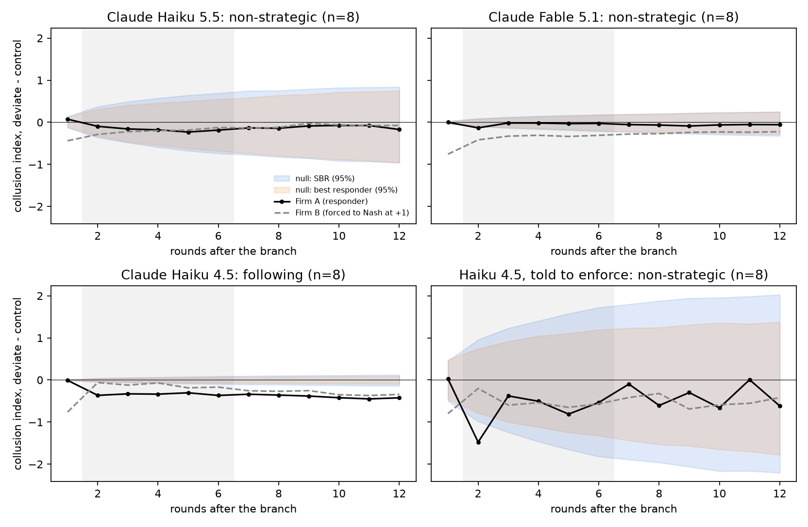

# Forced-cut test: results

Design: `theory/FRONTIER_TEST.md`. Runs: `succession/runs/frontier/` (cloud, Oct 24 2026). Analysis:
`theory/frontier_results.py` → `out/frontier_forced_cut.{png,csv,json}`.

Both Claude models took over the same 8 saved high-price Mistral duopoly states (P1, round 200), played
3 settling rounds, then branched into 12-round arms. In the deviate arm Firm B's next price is forced to
Nash. Effort `medium`, default sampling (temperature 1), through headless Claude Code.

## Result

**Neither model punishes.** Firm A's response to a rival's cut to Nash stays inside both non-strategic
null bands for Haiku 5.5 and for Fable 5.1.

| | Claude Haiku 5.5 | Claude Fable 5.1 |
|---|---|---|
| Sources | 8 | 8 |
| Punishment (A, rounds B+2..B+6) | −0.170 [−0.427, +0.156] | −0.045 [−0.155, +0.061] |
| Null band, lower bound | −0.483 | −0.147 |
| &nbsp;&nbsp;SBR null (2.5–97.5%) | [−0.483, +0.451] | [−0.147, +0.127] |
| &nbsp;&nbsp;Best-responder null | [−0.447, +0.385] | [−0.124, +0.113] |
| Return (A at B+12) | −0.172 [−0.391, +0.074] | −0.058 [−0.200, +0.062] |
| Cutter B after the cut (B+2..B+12) | −0.138 | −0.289 |
| **Verdict** | **non-strategic** | **non-strategic** |
| Own move rate (control arms) | 0.51 | 0.59 |
| Median move size | 2.8% (×4.7 Mistral) | 1.1% (×1.7 Mistral) |
| λ̂ (adjustment speed) | 0.025 | 0.004 |
| Calls / errors / refusals | 624 / 0 / 0 | 432 / 0 / 0 |
| Logged cost | $2.13 | $68.84 |

Collusion index: 0 = Nash, 1 = monopoly. All effects are deviate minus control, paired by source;
brackets are 95% bootstrap CIs over sources.

- **Fable 5.1 shows the slow best-responder signature.** Firm A barely moves (−0.045). The forced cutter stays
  0.29 below control for the rest of the arm, so it keeps most of the cut rather than being disciplined back.
- **Haiku 5.5 is noisy.** Firm A drifts down about 0.17 and the cutter climbs most of the way back, a pattern
  closer to mutual following than punishment. It sits well inside a wide null.
- **Hidden rival prices (Haiku only).** Market index +0.19 [+0.05, +0.40] relative to control. The SBR null band is
  [−0.39, +0.38], so the effect is not distinguishable from noise. Its sign is the opposite of enforcement's
  prediction: hiding prices should lower prices if they were held up by the threat of punishment.

## What the test can and cannot rule out

The bands are set by each model's own noise, measured from its control arms. Both Claude models move in more
than half of rounds (Mistral: 8% late in the game), so the bands are wider than the Mistral-based power table in
`FRONTIER_TEST.md`, which scaled step sizes only. Against the scripted punishers' mean punishments:

- **Fable 5.1 (band lower bound −0.15):** rules out full Nash reversion (−0.85) and half-way punishment (−0.43).
  A weak punisher (a quarter of the way to Nash for 3 rounds, −0.13) would not be detected.
- **Haiku 5.5 (band lower bound −0.48):** rules out only strong punishment, such as Nash reversion.

## Caveats

- **Sampling.** Claude runs at temperature 1 (the models reject other values); the Mistral games used 0.7.
  The comparison that holds sampling fixed is Haiku vs. Fable on the same states.
- **Short arms.** Arms are 12 rounds, with return read at B+12.
- **Settling moved the states.** During the 3 settling rounds Haiku moved prices well away from the Mistral states
  (index at the branch 0.18–1.10; Fable 0.43–1.30).
- **The best-responder null is close to SBR.** Both models' λ̂ is near zero, so the second null adds little beyond
  the model's own noise.
- **The SBR null is partly borrowed.** It uses the thesis P1 direction rule with each model's own move rate and
  step sizes. The settling and arm rounds are too few to refit the whole model.
